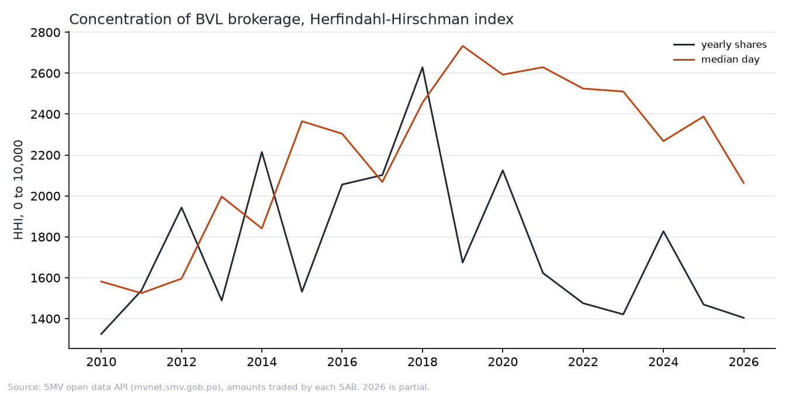
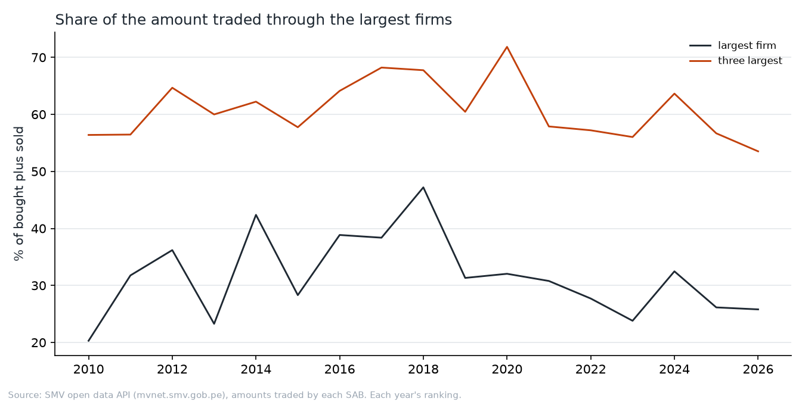
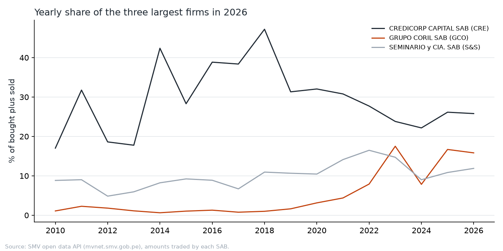
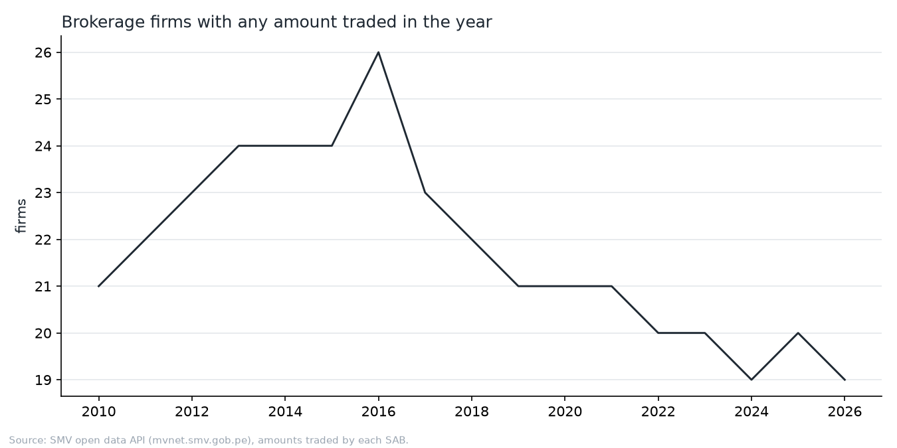

# How concentrated is BVL brokerage?

Every trade on the Lima Stock Exchange goes through a brokerage firm, a
sociedad agente de bolsa (SAB). The SMV publishes how much each firm bought and
sold on every market day since 1996. This study measures how the market splits
among the firms, year by year, and which firms lead it.

The panel has 7,615 market days from 1996-01-02 to 2026-11-13 and 31 firms.
The findings cover 2010 to 2026; the next section says why. 2026 runs to 13
November. Every number below is in [`numbers.json`](numbers.json), which
`bvl study brokers` rewrites.

## Method

- **Share.** A firm's share of a year is its bought plus sold amount over the
  year's total of both sides. A firm on both sides of a trade counts twice. The
  API's percentages are not used, because on some days they sum to less than
  100.
- **HHI.** The Herfindahl-Hirschman index is the sum of squared shares in
  percent. It runs from near 0 (many small firms) to 10,000 (one firm). The
  yearly HHI uses the year's shares. The median-day HHI is the median, over the
  year's market days, of the HHI of each day's shares.
- **Top 1 and top 3.** The year's share of its largest firm and of its three
  largest firms, ranked again each year.
- **Firms.** Firms with any amount traded in the year.

## The data before 2010 miss firms

Before 2010 the firms in the API account for well under the market's trading.
Coverage is the firms' bought amount over the traded amount in the BVL daily
quotes:

| Year | Coverage | Firms |
| ---- | -------: | ----: |
| 1996 |      42% |    12 |
| 2000 |     126% |    13 |
| 2005 |      77% |    14 |
| 2009 |      84% |    19 |
| 2010 |      95% |    21 |

From 2010 every year is above 90%, and from 2014 bought and sold totals are
equal on every day. Firms that stopped trading still appear (Argenta to 2000,
Capitaria to 2012, Citicorp to 2017), but the API lacks some of the firms that
traded in the 1990s. Shares before 2010 would overstate the firms it lists, so
the figures start in 2010. Coverage above 100% means the two sources count trades
or currencies differently; neither amount states its currency.

The API gives each firm code one name for all its days, today's. A firm here
carries its current name: BBVA SAB (code CON) for every year, for example.

## Concentration has no trend

| Year | HHI   | Median day | Largest firm | Its share | Top 3 | Firms |
| ---- | ----: | ---------: | ------------ | --------: | ----: | ----: |
| 2010 | 1,325 |      1,582 | Inteligo     |     20.3% | 56.4% |    21 |
| 2014 | 2,215 |      1,841 | Credicorp    |     42.4% | 62.2% |    24 |
| 2018 | 2,628 |      2,456 | Credicorp    |     47.2% | 67.8% |    22 |
| 2020 | 2,125 |      2,593 | Credicorp    |     32.0% | 71.8% |    21 |
| 2024 | 1,827 |      2,268 | BBVA         |     32.5% | 63.6% |    19 |
| 2026 | 1,404 |      2,063 | Credicorp    |     25.8% | 53.5% |    19 |

The yearly HHI moves between 1,325 (2010) and 2,628 (2018) with no direction.
The three largest firms hold between 53.5% (2026) and 71.8% (2020) of the
amount each year.

Since 2019 the median day is more concentrated than the year: 2,733 against
1,674 in 2019, and 2,063 against 1,404 in 2026. If every day had the same
shares, the two would match. The gap means the firms that carry a day's
trading change from day to day, and the year's shares spread wider than a
typical day's.

## Credicorp Capital leads, and Grupo Coril has risen

Credicorp Capital (CRE) was the largest firm in 13 of the 17 years: 2011, 2014
to 2023, 2025 and 2026. Its share peaked at 47.2% in 2018 and has been between
22.2% and 27.7% since 2022. BBVA SAB led in 2012, 2013 and 2024, and Inteligo in
2010.

BBVA's share jumps between years: 2.7% in 2023, 32.5% in 2024 and 4.2% in 2025.
A few large trades can make such a year; this study does not identify them.

Grupo Coril (GCO) first entered the top five in 2022, with 7.9%. It was second
in 2023 (17.5%), 2025 (16.7%) and 2026 (15.8%).

## Fewer firms

The firms with any trading rose from 21 in 2010 to 26 in 2016, then fell to 19
in 2024 and 2026.

## Limits

- A share counts both sides of every trade. It measures a firm's activity, not
  its clients' holdings, and it does not separate a firm's own trading from its
  clients'.
- Amounts carry no currency, and the BVL trades in soles and US dollars. A
  share mixes the two at face value.
- A single block trade can move a firm's yearly share by many points.
