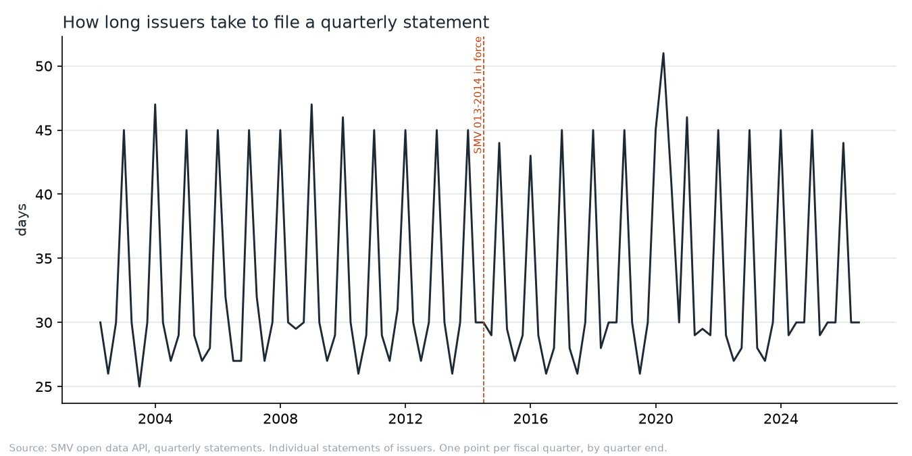
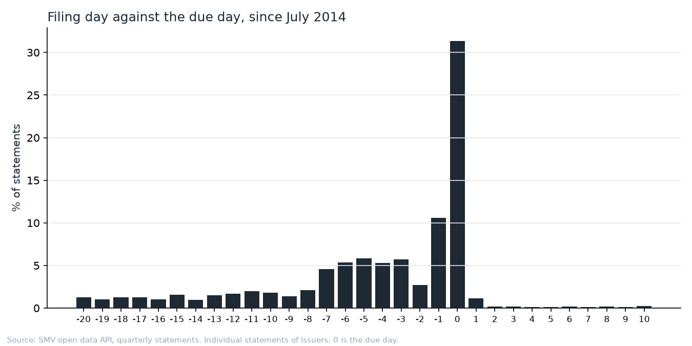
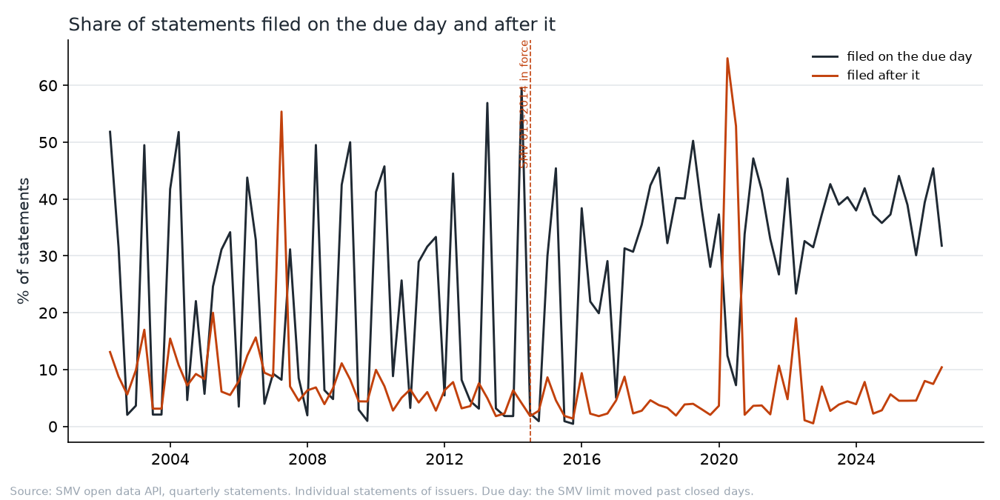
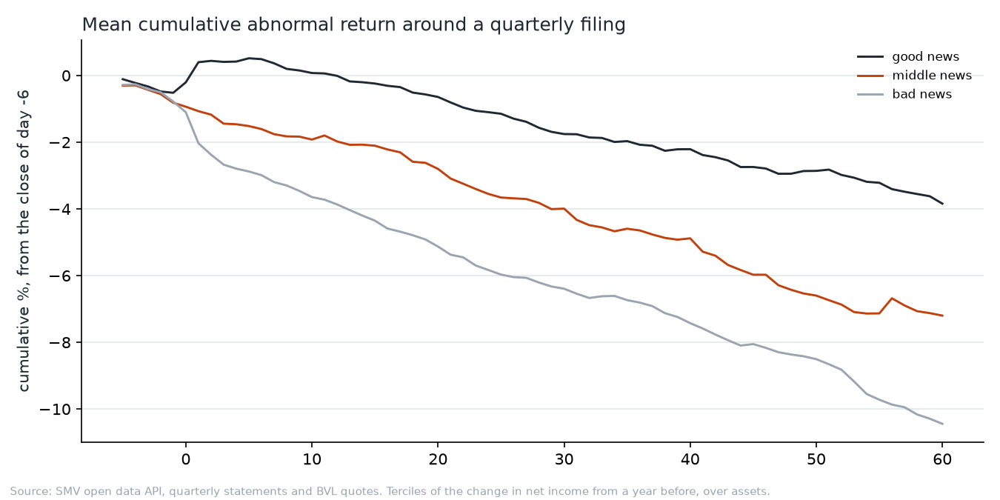

# When BVL issuers file their quarterly results, and how prices take them

Every issuer with securities on the Lima Stock Exchange files quarterly
statements with the SMV, and the SMV publishes a summary of each: total
assets, liabilities, equity, revenue and net income, with the day the SMV
registered it. This study asks two questions. When do issuers file, against
their legal limit? And do prices move with the news in the statement, on the
filing day and over the weeks after it?

The data hold 35,936 statements from 581 filers, 2002Q1 to 2026Q2. The timing
results use the individual statements of issuers (`EMPRESAS EMISORAS`): 19,693
statements from 384 issuers. Every number below is in
[`numbers.json`](numbers.json), which `bvl study earnings` rewrites.

## The limits

Article 7 of Resolución CONASEV 103-99-EF/94.10, as amended by
[Resolución SMV 013-2014-SMV/01](https://cdn.www.gob.pe/uploads/document/file/4191726/013-2014.pdf)
in force from 1 July 2014, gives an issuer 30 days after the quarter for its
individual statements and 45 for consolidated ones, and 45 and 60 days for the
fourth quarter. The SMV's yearly calendars turn these counts into dates. The
[2026 calendar](https://cdn.www.gob.pe/uploads/document/file/9343985/7661017-circular-calendarios-2026.pdf)
lists, for example:

| Statement               | Quarter | Limit      |
| ----------------------- | ------- | ---------- |
| Individual              | 2026Q2  | 31/07/2026 |
| Individual              | 2026Q3  | 2/11/2026  |
| Consolidated, 4th       | 2025Q4  | 2/03/2026  |
| Consolidated, 4th       | 2026Q4  | 1/03/2027  |

So a 30-day limit is the last day of the month after the quarter, a 45-day
limit the 15th of the second month, and the 60-day limit 60 calendar days,
1 March or 29 February in a leap year. A limit on a closed day moves to the
next business day. The study's due day applies this rule to every quarter. It
passes both the 2021 and the 2026 SMV calendars in the tests.

Closed days are weekends, Peru's national holidays, and the public-sector
non-working days that moved a limit:
31 October 2011 and 2 May 2011 ([DS 019-2011-PCM](https://noticierocontable.com/?p=3300)),
31 October 2019 ([DS 002-2019-PCM](https://busquedas.elperuano.pe/dispositivo/NL/1728509-1))
and 31 October 2022 ([DS 033-2022-PCM](https://lpderecho.pe/dias-no-laborables-sector-publico-2022-decreto-supremo-033-2022-pcm/)).
In each of those quarters the most common filing day is the next business day.
[DS 161-2021-PCM](https://img.lpderecho.pe/wp-content/uploads/2021/10/Decreto-Supremo-161-2021-PCM-LPDerecho.pdf)
also closed 2 November 2021, but the SMV's 2021 calendar kept that day as the
limit, and 50 issuers filed on it. It stays open here.

The BVL's own quote days are not a usable calendar for this. The quotes have no
market day from 27 July to 3 August 2026, so the 31 July 2026 limit would fall
on 4 August.

The limits before July 2014 are measured with the same rule. The filing lag
before and after 2014 has the same 30- and 45-day shape (below), but this study
did not read the earlier text of article 7. The summary since the rule uses
statements filed from 1 July 2014.

## Issuers file on the last day

The median issuer files 30 days after the quarter in the first three quarters
and 45 days after the fourth: at the limit, not before it.

Since July 2014, of 9,671 individual statements:

| Measure                        | All   | Issuer has a traded share | No traded share |
| ------------------------------ | ----: | ------------------------: | --------------: |
| Statements                     | 9,671 |                     5,297 |           4,374 |
| Median lag, days               |    30 |                        30 |              30 |
| Filed on the due day           | 31.3% |                     35.7% |           26.1% |
| Filed after it                 |  6.7% |                      7.3% |            5.9% |
| Filed more than 30 days after  |  2.7% |                      3.0% |            2.2% |

31.3% file on the due day and 10.6% the calendar day before. 1.2% file one
day after it, and from the second day on, each day holds 0.1% to 0.2%.
Issuers with a traded share file on the due day more often than those with
only bonds or other securities, not earlier.

The share on the due day swings before 2017 because issuers read the 30-day
limit differently. From 2012 to 2015, 38% to 51% of second- and third-quarter
individual statements came on 30 July or 30 October, plain 30 calendar days,
and under 9% came on the 31st. By the SMV's reading they filed a day early. In
2017 and 2018 the 31st took 31% to 40%, and the 30th 0% to 20%. From 2017 the
share on the due day stays between 23% and 50%, apart from 2020.

Two quarters of 2020 stand out: 64.8% of first-quarter and 52.8% of
second-quarter statements came after the ordinary limit. In the other quarters
since 2017, 0.5% to 11% did, apart from 19% in 2022Q1. The SMV extended the limits during the COVID-19
emergency; [Resolución de Superintendente 033-2020-SMV/02](https://gestion.pe/economia/coronavirus-en-peru-smv-prorroga-plazo-para-presentacion-de-informacion-financiera-por-estado-de-emergencia-covid-19-nndc-noticia/)
moved the first quarter's individual limit to 31 July 2020. The study measures
2020 against the ordinary limit and does not model the extensions. The 2020Q2
filings bunch on 30 September.

## Prices move with the news on days 0 and 1

**Earnings news** is the change in a quarter's net income from the same quarter
a year before, over the year-earlier total assets. The BVL has no analyst
forecasts for most issuers, so the news is measured against a year before,
and part of it was expected. A filer that changed its reporting currency in
between has no news.

**Events** are the individual statements of issuers with a share in the BVL
quotes, on the issuer's most-traded ticker at the time. Day 0 is the first
market day on or after the filing day; the data carry no filing time. An event
needs 10 trades in days −250 to −30. The sample holds 5,035 events from 120
issuers and 142 tickers, filed from 2003-04-23 to 2026-11-02.

**Abnormal return** is the stock's daily log return less the equal-weighted
market index of local shares ([docs/BVL.md](../../docs/BVL.md#the-panel)),
summed over a window: days −5 to −1 before the filing, days 0 to 1 for the
reaction, and days 2 to 60 for the drift. A day the stock does not trade adds
nothing.

Events are split into terciles of the news, and also by its sign. The table
gives the good-news mean less the bad-news mean, with a 95% bootstrap interval
that resamples day 0, so that filings on the same day move together.

| Window     | Terciles, good less bad | 95% interval  | By sign | 95% interval  |
| ---------- | ----------------------: | ------------- | ------: | ------------- |
| Days −5 to −1 |                 +0.25% | −0.11, +0.66 |  +0.13% | −0.27, +0.50 |
| Days 0 to 1   |                 +2.15% | +1.74, +2.59 |  +1.55% | +1.23, +1.89 |
| Days 2 to 60  |                 +3.84% | +2.15, +5.38 |  +3.36% | +1.99, +4.77 |

The top tercile (1,678 events) gains 0.90% on days 0 and 1 and the bottom
tercile (1,679) loses 1.25%. Before the filing the gap is +0.25%, and its
interval includes zero: prices do not move with the news ahead of the filing.

After day 1 the gap keeps widening, to +3.84% by day 60. Prices take the news
over weeks, not in a day.

All three terciles fall against the market over the 60 days: the good tercile
by 3.96% and the bad one by 7.80%. The equal-weighted index drifts up from
trades alternating between bid and ask, which is negligible over a few days but
not over 60. The gap between terciles takes that shared drift out, and it is
the result here; the level of each line is not.

By period, terciles of news:

| Filed   | Good | Bad | Days 0 to 1 | 95% interval | Days 2 to 60 | 95% interval |
| ------- | ---: | --: | ----------: | ------------ | -----------: | ------------ |
| 2002-09 |  569 | 500 |      +3.32% | +2.58, +4.16 |       +4.06% | +1.01, +6.70 |
| 2010-14 |  435 | 427 |      +1.43% | +0.72, +2.55 |       +4.43% | +1.18, +8.00 |
| 2015-19 |  305 | 358 |      +1.97% | +1.15, +2.67 |       +3.86% | −0.50, +8.26 |
| 2020-26 |  369 | 394 |      +1.43% | +0.93, +1.93 |       +3.23% | +0.41, +5.91 |

The reaction on days 0 and 1 was largest before 2010 and has held between 1.4%
and 2.0% since. The drift appears in every period at 3% to 4.5%, though the
2015-19 interval includes zero.

## Limits

- **Filing date.** The API's date is the day the SMV registered the statement.
  For an amended statement it may be the amendment's date, which makes an
  on-time filing look late.
- **Summary accounts only.** The API carries five accounts and no notes or
  forecasts. The news measure counts an expected change as news, which
  understates the reaction to the surprise.
- **Accounting change.** Peru moved listed companies to IFRS in 2011 and 2012.
  A year-on-year change across the switch mixes earnings with the new
  standard.
- **Individual statements.** The event study uses individual statements. For a
  group the consolidated one, filed two weeks later, may carry more of the news.
- **The 2023 fourth-quarter consolidated limit.** By the rule it was 29
  February 2024, but 1 March was the most common filing day, and 40% count
  as late. Without the SMV's 2024
  calendar the study keeps the rule. Consolidated statements are not in the
  results above.
- **Drift near the end.** An event needs 60 market days after day 0 for the
  drift. Events filed from about August 2026 have a shorter drift window, and
  the drift sums only the days they have.
- **Thin trading.** Many BVL stocks trade on few days. A price that does not
  move on a day without trades lands the news on the next trade, so part of
  the drift may be a slow reaction, not a mispricing.
