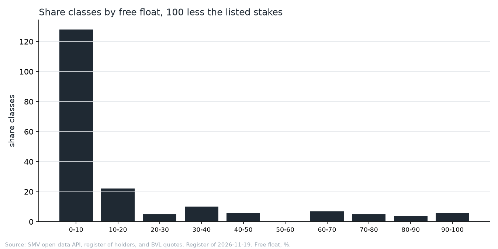
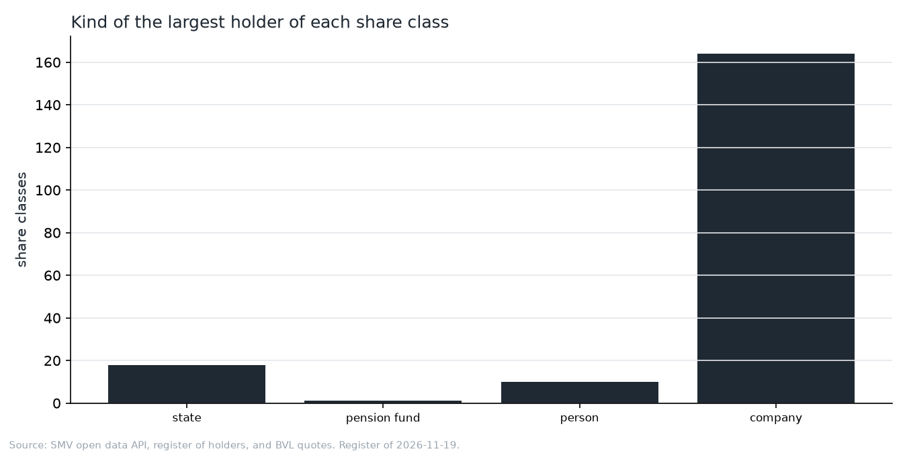
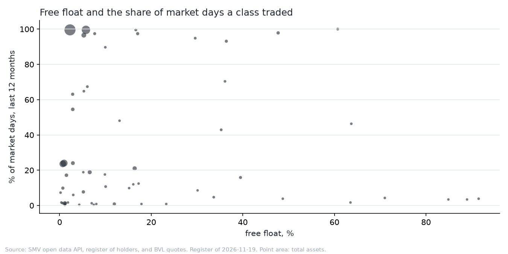

# Who holds BVL issuers, and does a concentrated register trade less?

The SMV publishes a register of the large holders of each issuer it
supervises: the holder, their nationality, their stake and the share class.
This study reads the register from the SMV open data API
([`registro/AccionistaSMVEmisor`](https://mvnet.smv.gob.pe/SMV.OData.Api/api/registro/AccionistaSMVEmisor))
and asks two questions. How concentrated is the ownership of Peruvian issuers?
And do share classes with more free float trade more?

The API answers only the current register, so the study is one snapshot,
fetched on 2026-11-19. Every number below is in
[`numbers.json`](numbers.json), which `bvl study ownership` rewrites.

## The register

The snapshot lists 444 holdings. Eighteen belong to eight foreign issuers,
among them Credicorp, Southern Copper and InRetail. The register files them all
under RUC `0`, so the study leaves them out. That leaves 426 holdings in 186
Peruvian issuers.

The smallest listed stake is 4.02%. The study treats every holder below the
register's cut-off as outside it, and does not assume what the cut-off is.

Each holder gets one of four kinds from its name:

| Kind         | Holdings | Read from the name                                          |
| ------------ | -------: | ----------------------------------------------------------- |
| Company      |      319 | anything not below                                          |
| Person       |       71 | `SURNAMES, NAMES` with no legal form such as `S.A.` or `LLC` |
| State        |       22 | `ESTADO`, a municipality, FONAFE, the FCR reserve fund      |
| Pension fund |       14 | an AFP or one of its funds (`HA-FONDO 2`)                   |

160 holdings are foreign by the register's nationality. The most common
nationalities are Panama (36), Chile (19), the United States (19), the US
Virgin Islands (12) and Colombia (11).

## Classes and free float

A stake is a stake in one class of shares. The register names the class in
many ways: blank, `COMUNES`, `Acciones Comunes`, `CAPITAL` or the ticker
`MINCORC1` all mean the common shares, and `A` to `D` name a lettered class.
Sixteen holdings name several classes at once (`AyB`, `A,B,C`), a founders'
class or an `S1` series. They are left out, since their stake cannot be split
by class.

That gives 193 classes. A class's **block holdings** are its listed stakes
summed, and its **free float** is 100 less that sum: what holders under the
register's cut-off own. This is an upper bound on the float that trades,
since several small holders may be one family or group.

The median class has a free float of 2.86%. 128 of the 193 classes have less
than 10% outside the listed holders, and 23 have none. In 71.5% of classes one
holder owns more than half, and in 34.2% of all classes that holder is
foreign.

The largest holder is a company in 164 classes, the state in 18, a person in
10, and a pension fund in 1, Ferreycorp.

## Free float and trading

**Trading** is measured on the class's ticker over the 12 months to
2026-11-13, the last market day in the quotes. A class matches a ticker by the
issuer's name in the quotes, and a lettered class by its letter (`VOLCAAC1` for
Volcan's class A). Two measures:

- **Coverage**: the share of market days the ticker traded.
- **Amihud illiquidity**: the mean daily |log return| over the traded amount
  in each month, then the median over the months with enough trading days.
  Higher is less liquid. The quotes carry no currency for the amount, and most
  shares trade in soles.

89 classes have a ticker. 31 of those did not trade at all in the year, and
one, Agro Pucalá, has no statement with its total assets, which leaves a sample
of 57.
36 of them trade often enough for an Amihud measure.

**Size** is the issuer's total assets in its latest individual statement, with
dollar statements converted at the BCRP exchange rate. Each test is a rank
correlation (Spearman) with a 95% bootstrap interval that resamples classes.
"Given size" is the partial correlation: the ranks of both measures less what
the rank of size predicts.

| Test                                | Classes |    rho | 95% interval   |
| ----------------------------------- | ------: | -----: | -------------- |
| Free float and coverage             |      57 |  0.109 | −0.154, 0.358  |
| Free float and coverage, given size |      57 |  0.393 | 0.156, 0.584   |
| Size and coverage                   |      57 |  0.572 | 0.366, 0.724   |
| Size and free float                 |      57 | −0.340 | −0.547, −0.089 |
| Free float and Amihud               |      36 | −0.369 | −0.646, −0.037 |
| Free float and Amihud, given size   |      36 | −0.560 | −0.767, −0.249 |

On its own, free float tells little about how often a class trades: the
interval includes zero. Size hides the effect. Larger issuers trade more, and
they also have more concentrated registers: banks, utilities and mines held
by a parent. Once size is held fixed, more free float goes with trading on
more days (0.393) and with a lower Amihud measure (−0.560). Both intervals
exclude zero.

By band of free float:

| Free float | Classes | Median coverage | Median Amihud, per million traded |
| ---------- | ------: | --------------: | --------------------------------: |
| 0-10%      |      30 |           17.4% |                             0.734 |
| 10-25%     |      11 |           12.0% |                             0.650 |
| 25-50%     |       9 |           42.9% |                             0.093 |
| 50-100%    |       7 |            3.9% |                             0.721 |

The bands do not rise steadily, because they do not hold size fixed. Six of
the seven classes with more than half their shares outside the register trade
on under 50% of days. They belong to small issuers, such as sugar companies
and regional utilities, whose shares are spread among many small holders.
Ferreycorp, with no holder above 10%, trades every day.

## Limits

- **One snapshot.** The API has no history, so the study cannot say whether
  ownership changed or whether a change in float moved trading. Running
  `bvl fetch holders` again adds a new dated snapshot.
- **Free float is an upper bound.** Holders under the cut-off may act
  together, and a listed holder may be a vehicle of another. The register does
  not link them.
- **Per class, not per issuer.** A stake in a lettered class is a stake in
  that class only. Holdings that name several classes are left out.
- **Foreign issuers.** The eight issuers under RUC `0` are excluded, so the
  largest BVL names by market value (Credicorp, Southern Copper) are not in
  the study.
- **Kinds from names.** A holding company owned by the state or by a person
  counts as a company.
- **Selection.** The trading tests use the 57 classes that traded in the year
  and have a statement. Classes that never trade are left out, which removes
  the least liquid end.
- **Small sample.** With 57 and 36 classes, the intervals are wide. The
  direction of the effect given size is clear; its size is not.
