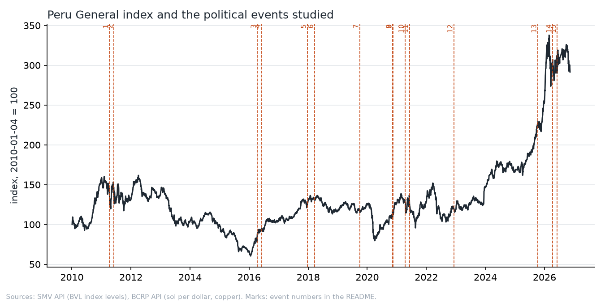
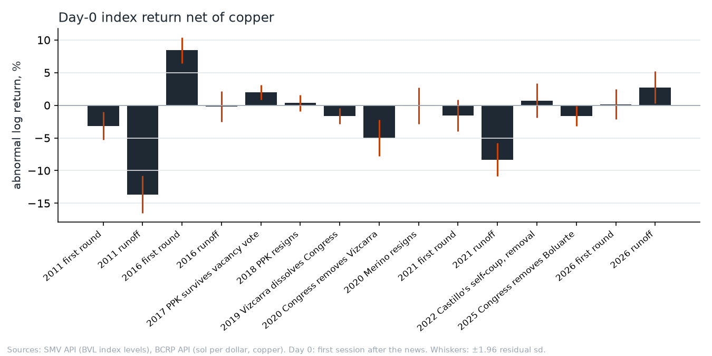
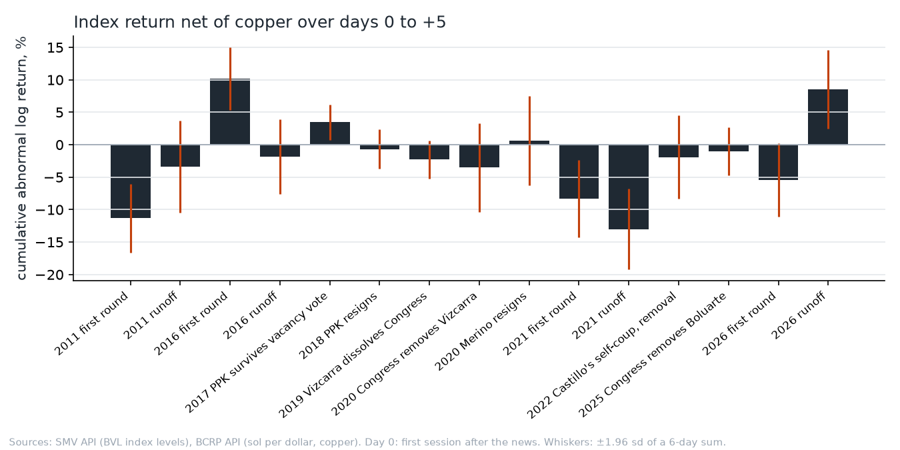
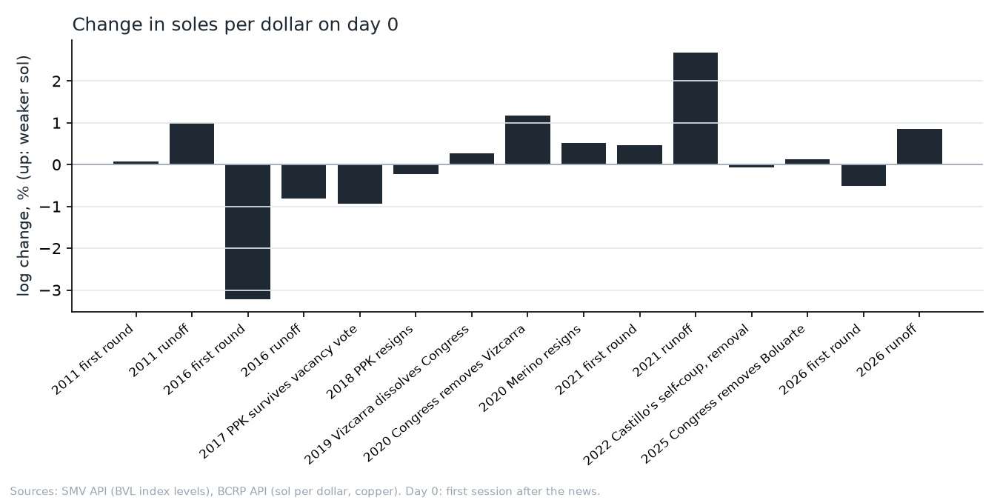

# How the BVL and the sol take Peru's political shocks

Peru has held four presidential elections since 2011, and five
presidents have left office early since 2018. This study measures how the Lima Stock Exchange and the
sol moved on the first session after 15 of those events, and over the
following week. It asks which shocks the market priced and which it ignored.

The index is the Peru General: the IGBVL to April 2015, the S&P/BVL Peru
General to August 2025 and the MSCI NUAM Peru General after it. There are 7,589
market days from 1996-01-02 to 2026-11-13. The exchange rate and copper come
from the central bank (BCRP). Every number below is in
[`numbers.json`](numbers.json), which `bvl study politics` rewrites.

## Method

- **Day 0** is the first session that could react to the news. A Sunday vote
  has day 0 on Monday. A Congress vote that ended at night has day 0 on the
  next day. Castillo's self-coup came during the session of 7 December 2022,
  and Congress removed him the same afternoon, so day 0 is that session.
- **Abnormal return** is the index's daily log return less a market model on
  copper, Peru's largest export. The model is fitted by least squares on days
  −260 to −11, which is 250 sessions ending two weeks before the event.
- **z** divides the abnormal return by the model's residual sd. A cumulative
  window of 6 days divides by the sd times √6. Under a normal residual, |z|
  above 1.96 happens on 1 day in 20.
- **Sol** is the BCRP's interbank sell rate in soles per dollar. A rise is a
  weaker sol. Its z divides by the sd of its daily change over the same
  estimation window.
- **Days as large** is the share of all 7,589 market days whose index move was
  at least as large as the day-0 move, in either direction.

## Results

| #   | Day 0      | Event                         |  Return | Abnormal (z)   | Days 0 to +5 (z) | Sol, day 0 (z) | Sol, days 0 to +5 (z) | Days as large |
| --: | ---------- | ----------------------------- | ------: | -------------: | ---------------: | -------------: | --------------------: | ------------: |
|   1 | 2011-04-11 | 2011 first round              |  −3.1%  | −3.1% (−2.9)   | −11.3% (−4.2)    | +0.1% (+0.7)   | +0.9% (+3.0)          | 3.24%         |
|   2 | 2011-06-06 | 2011 runoff                   | −13.3%  | −13.6% (−9.3)  | −3.4% (−0.9)     | +1.0% (+6.7)   | −0.1% (−0.4)          | 0.01%         |
|   3 | 2016-04-11 | 2016 first round              |  +8.4%  | +8.4% (+8.4)   | +10.2% (+4.1)    | −3.2% (−11.3)  | −3.9% (−5.6)          | 0.16%         |
|   4 | 2016-06-06 | 2016 runoff                   |  +0.0%  | −0.2% (−0.2)   | −1.8% (−0.6)     | −0.8% (−2.0)   | −0.4% (−0.4)          | 99.64%        |
|   5 | 2017-12-22 | PPK survives vacancy vote     |  +2.2%  | +2.0% (+3.5)   | +3.5% (+2.5)     | −0.9% (−4.2)   | −1.3% (−2.4)          | 7.10%         |
|   6 | 2018-03-21 | PPK resigns                   |  +0.5%  | +0.4% (+0.6)   | −0.7% (−0.4)     | −0.2% (−1.1)   | −1.2% (−2.4)          | 52.50%        |
|   7 | 2019-10-01 | Vizcarra dissolves Congress   |  −1.8%  | −1.7% (−2.7)   | −2.3% (−1.5)     | +0.3% (+1.1)   | −0.2% (−0.3)          | 10.82%        |
|   8 | 2020-11-10 | Congress removes Vizcarra     |  −6.4%  | −5.0% (−3.5)   | −3.5% (−1.0)     | +1.2% (+2.9)   | +1.1% (+1.1)          | 0.40%         |
|   9 | 2020-11-16 | Merino resigns                |  +1.4%  | −0.1% (−0.0)   | +0.6% (+0.2)     | +0.5% (+1.3)   | −1.3% (−1.3)          | 17.99%        |
|  10 | 2021-04-12 | 2021 first round              |  −1.9%  | −1.6% (−1.3)   | −8.3% (−2.7)     | +0.5% (+1.3)   | +1.5% (+1.7)          | 9.98%         |
|  11 | 2021-06-07 | 2021 runoff                   |  −8.3%  | −8.3% (−6.4)   | −13.0% (−4.1)    | +2.7% (+6.3)   | +1.7% (+1.6)          | 0.18%         |
|  12 | 2022-12-07 | Castillo's self-coup, removal |  +0.5%  | +0.7% (+0.5)   | −1.9% (−0.6)     | −0.1% (−0.1)   | −0.4% (−0.3)          | 56.81%        |
|  13 | 2025-10-10 | Congress removes Boluarte     |  −1.8%  | −1.6% (−2.1)   | −1.0% (−0.5)     | +0.1% (+0.4)   | −1.4% (−1.9)          | 10.67%        |
|  14 | 2026-04-13 | 2026 first round              |  +0.9%  | +0.2% (+0.1)   | −5.5% (−1.9)     | −0.5% (−1.5)   | +1.4% (+1.7)          | 33.09%        |
|  15 | 2026-06-08 | 2026 runoff                   |  +2.6%  | +2.8% (+2.2)   | +8.5% (+2.8)     | +0.8% (+2.4)   | −2.1% (−2.4)          | 4.88%         |

Returns are log changes. The event numbers match the marks on the index chart.

## Elections move the market most

The three largest day-0 moves came after elections:

- **The 2011 runoff** (6 June 2011) is the largest daily move in the whole
  series: −13.3%, with an abnormal return of −13.6% (z = −9.3). No other day
  since 1996 moved as much. The exchange halted trading that session. The
  sol weakened 1.0%, a z of 6.7 against its own volatility. Most of the fall
  came back within the week: days 0 to +5 sum to −3.4%.
- **The 2016 first round** (11 April 2016) gave a +8.4% abnormal return (z =
  8.4). It is the only event where the sol moved more than the index in z
  terms: it strengthened 3.2% (z = −11.3). The runoff went to Keiko Fujimori
  and Pedro Pablo Kuczynski, and the left's candidate, Verónika Mendoza, did
  not qualify.
- **The 2021 runoff** (7 June 2021) gave −8.3% (z = −6.4), and the week
  added more: −13.0% over days 0 to +5 (z = −4.1). The sol weakened 2.7% on
  day 0 (z = 6.3), its largest day-0 move after 2016's first round.

First rounds also drifted. In 2011 and 2021 the day-0 abnormal return was
modest (−3.1% and −1.6%), but the week added up to −11.3% and −8.3%. The
2026 first round shows the same pattern: +0.2% on day 0, −5.5% over the week
(z = −1.9). The 2026 runoff reversed it, with +2.8% on day 0 and +8.5% over
the week (z = 2.8).

## Removals and resignations mostly do not

Peru's crises in Congress moved the index less than elections did:

- Congress's removal of Vizcarra (10 November 2020) is the exception: −5.0%
  abnormal (z = −3.5), and the sol weakened 1.2% (z = 2.9). The week recovered
  part of it, and the cumulative z is −1.0. His successor, Merino, resigned
  five days later. That day's abnormal return was −0.1%.
- Vizcarra's dissolution of Congress (−1.7%, z = −2.7) and Boluarte's removal
  (−1.6%, z = −2.1) cross the 1.96 line on day 0 but not over the week.
- Castillo's self-coup and removal on 7 December 2022 left the index +0.7%
  at the close (z = 0.5). The day closed after Congress had removed him, so
  the close prices both the attempt and its failure.
- PPK's resignation (+0.4%) was expected: the vote-buying videos came out on
  20 March 2018, the day before. Surviving the first vacancy vote three months earlier was worth +2.0%
  (z = 3.5), and the sol strengthened 0.9% (z = −4.2).

## What the numbers do not show

- **The z scores overstate certainty.** Daily index returns have fat tails, so
  a |z| above 1.96 is more common than 1 in 20. The "days as large" column
  needs no distribution: the 2011 runoff ranks first of 7,589 days, the 2016
  first round 12th, and the 2021 runoff 14th.
- **Copper is the only control.** World equity moves are not netted out, and a
  global shock on day 0 would sit in the abnormal return. The BCRP's copper
  price is a London quote, not a price at the Lima close.
- **The index changes family twice.** Each family weights stocks differently,
  so a move of the IGBVL in 2011 and of the MSCI NUAM index in 2026 are not
  the same basket.
- **Events were chosen as news, not by returns.** The list covers every
  presidential vote since 2011 and the main removals and resignations since
  2016. It includes events that moved nothing. Other events were left out:
  the Boluarte government's protests of 2022-23, for example, have no single
  day 0.
- **The direction of a reaction is not a judgment on a candidate.** It
  measures what investors expected for mining, taxes and the sol on that day.

Sources for event timing: the BVL's halt on 6 June 2011 is reported by
[Emol](https://www.emol.com/noticias/economia/2011/06/06/485774/bolsa-de-peru-registra-la-mayor-caida-de-su-historia-tras-el-triunfo-de-humala.html)
and [Conexión ESAN](https://esan.edu.pe/conexion-esan/despues-de-la-tormenta-siempre-llega-la-calma);
the 2016 first-round rally by the
[Banco de la Nación](https://www.bn.com.pe/atencion-cliente/informe-economico/2016/ReportExtr110416.pdf)
and [Peru Reports](https://perureports.com/peru-markets-rally-leftist-fails-qualify-runoff/3752/).
